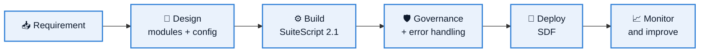

 

---

## 👋 About me

I build **NetSuite customizations, integrations and automation** that stay maintainable after go-live. 1+ year of hands-on work across SuiteScript 2.1, RESTlets, Suitelets, Map/Reduce, Fixed Asset Management and third-party integrations, plus a public weekly learning series.

> *"Good systems reduce chaos. Great engineering reduces friction."*

| 🔭 Now | 🌱 Learning | 💬 Ask me about |
|---|---|---|
| NetSuite AI features and Claude + MCP integration | SuiteCloud Developer certification path, architecture patterns | SuiteScript, integrations, SDF, Saved Search performance |

---

## 🆕 Latest from the series

| 📅 | 📘 Topic | 🔗 |
|---|---|---|
| **Week 29** | New AI Features in NetSuite: from Text Enhance to the Autonomous Suite | [Read](https://github.com/ManojMohite2002/NetSuite-Learning) |
| **Week 28** | Advanced Saved Search and Performance | [Read](https://github.com/ManojMohite2002/NetSuite-Learning) |
| **Coming** | Field Note #01: Connecting Claude AI to NetSuite | 🚧 |

---

## 🛠️ Tech stack

<b>⚙️ NetSuite capabilities (click to expand)</b>

| Area | What I work with |
|---|---|
| **Scripting** | User Event, Client, Scheduled, Map/Reduce, Workflow Action, Suitelet, RESTlet |
| **Customization** | Custom records, Saved Searches, workflows, PDF and email automation |
| **Integrations** | REST APIs, OAuth 2.0, Slack, HR systems, JSON/XML processing, Postman testing |
| **Finance** | Fixed Asset Management, approval flows, statements and reporting |
| **Tooling** | SDF projects, VS Code, multi-environment deployment |

---

## 📌 Featured work

| 🔹 Project | ⚙️ What it does | 🧰 Built with |
|---|---|---|
| **Slack Approval Integration** | Approve Purchase Orders from Slack with signature-validated requests | SuiteScript, RESTlet, Slack API |
| **HR to NetSuite Daily Sync** | Scheduled sync of employee data with layered modules, logging and error handling | Map/Reduce, OAuth 2.0, config-driven design |
| **Project Profitability Engine** | Reporting with dynamic filters and a modular service layer | Suitelet + RESTlet, governance-aware design |
| **Vendor Statement Refactor** | Legacy script modernised to SuiteScript 2.1 with paginated UI before PDF/CSV export | Suitelet, N/search, pagination |
| **ERP Automation Utilities** | Reusable bulk processing, error aggregation, logging | Config-driven mapping, search optimisation |

> 🔒 Client details and production code are never published here. Everything in my public repos is sanitised or built from scratch for learning.

---

## 🏗️ How I build

✅ Modular, service-based structure &nbsp;•&nbsp; ✅ Governance-aware scripts &nbsp;•&nbsp; ✅ Clean logging and error handling &nbsp;•&nbsp; ✅ Config-driven behaviour &nbsp;•&nbsp; ✅ Scalable integration design

---

## 📚 Learning in public

Every Sunday I document one NetSuite concept with notes, diagrams and code, from ERP fundamentals to Map/Reduce, tax architecture, Saved Search performance and now AI integration. I also publish short **Field Notes** from real work: what I built, what broke, what I learned.

👉 **[Browse the NetSuite-Learning repo](https://github.com/ManojMohite2002/NetSuite-Learning)**

---

## 📊 GitHub stats

---

## 🤝 Let's connect

I'm happy to talk NetSuite, integrations and AI in ERP. If you're building something similar, or want a topic covered in the series, reach out.

😄 *I enjoy automating repetitive business work because humans looked at a daily manual process and said "this is fine, let's do it forever."*

